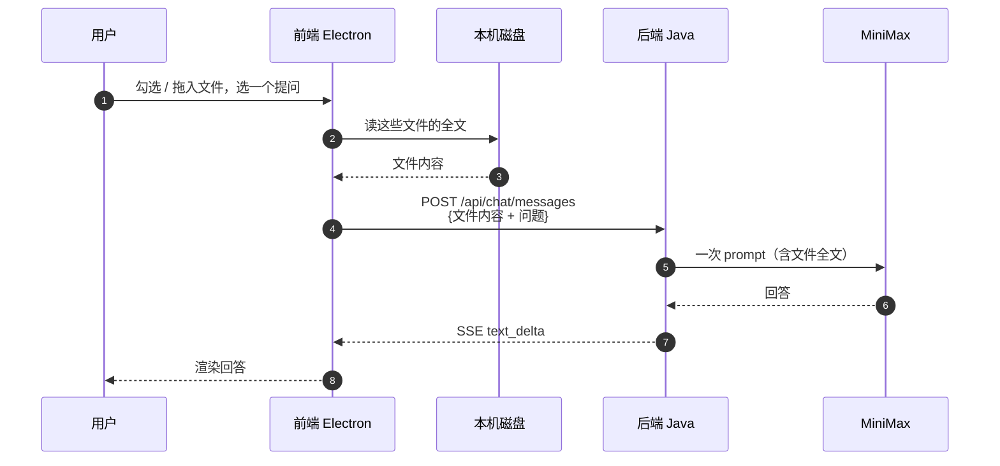
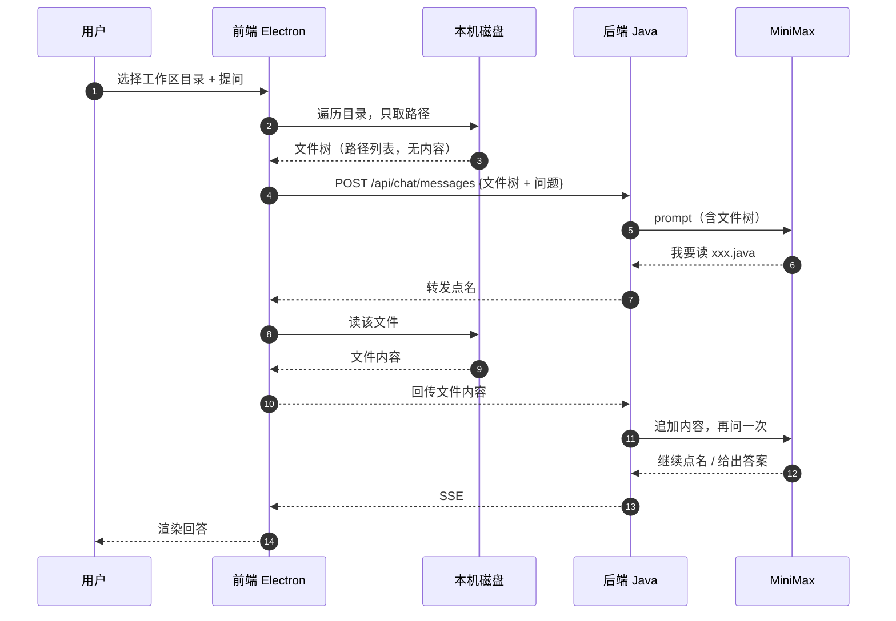
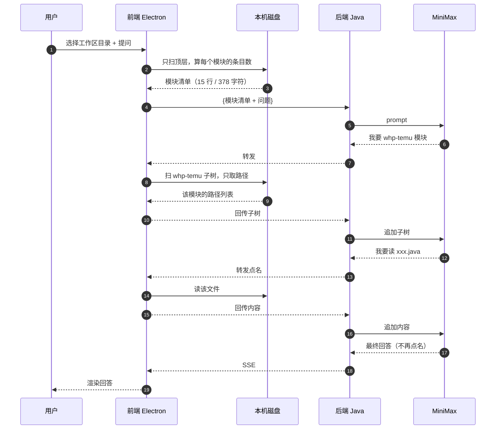
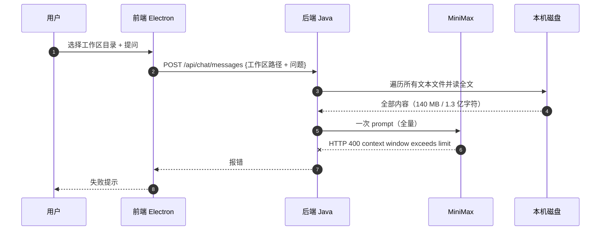
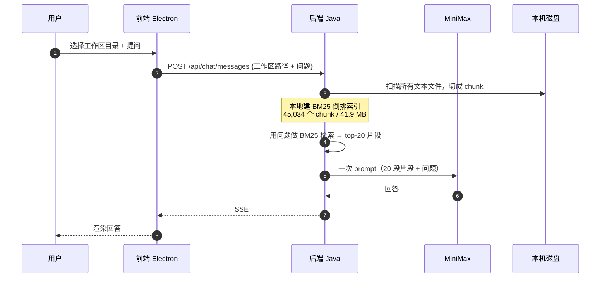
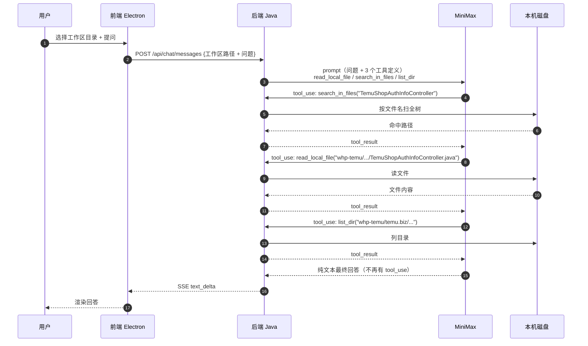
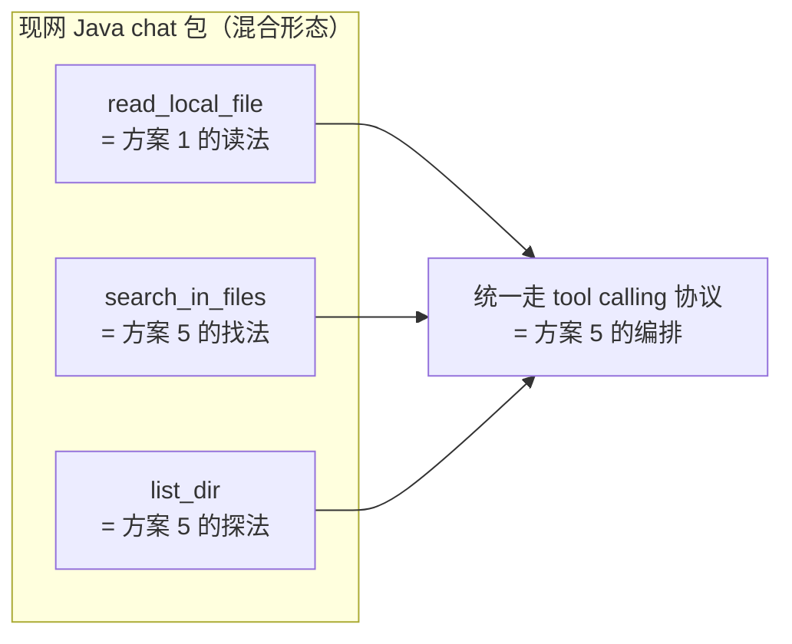

# 取文件方式：5 种方案的完整流程（Mermaid 对照）

> 这份文档只画**流程**，不对方案做评价。每张图后面附「关键节点」和「实测断点」，
> 用来核对「是不是你想的那种」。

## 参与者约定

| 代号 | 是什么 |
|---|---|
| `U` | 用户 |
| `FE` | 前端 / Electron 渲染层 + preload（**唯一能直接读本机磁盘的进程**） |
| `BE` | 后端 Java（Spring Boot 单体，持有 LLM 编排和工具） |
| `LLM` | MiniMax-M3.1-Flash（Anthropic 兼容端点） |
| `FS` | 本机磁盘（用户选的工作区目录） |

---

## 方案 1：前端直读「选中文件」的全文 → 给后端 LLM

**关键节点**
- **谁读文件**：前端
- **谁决定读什么**：用户（或调用方）事先指定，模型不参与
- **请求次数**：1 次
- **上下文里是什么**：被选中文件的**全文**
- **后端完全不知道文件系统的存在**，也不需要知道

**实测**：10/10（2 次调用 / 1,943 tok / 7.1s），但这是 **oracle**——基准台里文件名是我硬编码的答案。
真实场景下是「用户指定」，用户选对了就满分，选错了就是 0 分。

---

## 方案 2：前端只给文件树 → LLM 点名 → 前端读 → 回传（多轮）

**关键节点**
- **谁读文件**：前端（但读哪个是 LLM 说了算）
- **谁决定读什么**：LLM
- **请求次数**：N 次，**每轮都要重发整棵文件树**
- **上下文里是什么**：第 1 轮是文件树，之后是「树 + 已读文件内容」的累积
- **后端也不读磁盘**，纯转发

**实测**：0/10（20 次调用 / **440,970 tok** / 201s）
**断点**：文件树按字母序深度优先，答案模块 `whp-purchase` 排第 9、`whp-temu` 排第 11。
按 148 万字符截断时裁到 `whp-order` 就断了 —— 两个答案文件**连目录都不在树里**，模型只能猜路径。

---

## 方案 2b：方案 2 的两级树变体（先模块清单，再按模块下发子树）

**关键节点**
- **谁读文件**：前端
- **谁决定读什么**：LLM，但**分两级收敛**（先选模块，再选文件）
- **请求次数**：N 次，每轮重发的上下文比方案 2 小一个量级
- **实测**：检索层已验证成功 —— 读到的正是和方案 5 **完全一样的 2 个文件 / 2,892 字节**，
  6 次调用 / 29,663 tok（只有方案 2 的 1/15）。最终评分待额度恢复后补。

---

## 方案 3：后端直接读取，把内容**全部**给 LLM

**关键节点**
- **谁读文件**：后端
- **谁决定读什么**：全都要，没有选择
- **请求次数**：1 次（然后被服务端拒）
- **上下文里是什么**：工作区全部文本（140.1 MB / 1.3 亿字符 ≈ 4,360 万 token）

**实测**：服务端 `HTTP 400 invalid params, context window exceeds limit (2013)`
**断点**：即使按最乐观的 16 字符/token 密度算也有 818 万 token，**确定超出上限区间上界**（263 万）。
死路，和模型能力无关。

---

## 方案 4：后端一次性检索（分段式读取），把 top-k 片段给 LLM

**关键节点**
- **谁读文件**：后端（**一次性全读**，只是发出去的是片段不是全文）
- **谁决定读什么**：BM25 打分决定，模型不参与
- **请求次数**：1 次
- **上下文里是什么**：20 段相关片段（约 24 KB）+ 片段来自哪些文件的标注

**实测**：3/10（2 次调用 / 15,021 tok / 105.9s）
**断点**：**检索阶段就漏了** —— 答案文件在 BM25 **top-200 都排不进**。
top-8 全被三份总结型长 md 占满（`阅读顺序.md`、`项目架构概览.md`、`API_INTERFACE_SUMMARY.md`）；
加文件名加权后 top-8 只是换成 `TemuDailySalesClient` 之类无关类，仍不含答案文件。
那 3 分是模型从配置文件里**偶然**捞到的 `/ocean1688/auth/callback`，它自己都说「未检索到对应的 @RestController 文件」，Q1 直接 0/5。

---

## 方案 5：LLM 直接绑定读取能力，自己决定什么时候读什么

**关键节点**
- **谁读文件**：后端（**工具执行在 Java 进程里**）
- **谁决定读什么**：LLM 自己
- **请求次数**：N 次，**每次只带上一轮的工具结果**，不重发大段上下文
- **上下文里是什么**：增量 —— 模型点了什么才给什么
- **前端完全不知道模型要读哪个文件**

**实测**：10/10（16 次调用 / 读 5 个文件 12,476 字节 / 21,600 tok / 37s）
**优点**：唯一不依赖「事先知道答案文件」的满分方案；读取字节最省；天然支持多轮追问。
**代价**：token 比方案 1 多（多轮工具往返）。

---

## 五种方式放一起看

```mermaid
flowchart TB
    subgraph S1["方案 1 前端直读选中文件"]
        A1["用户指定文件"] --> A2["前端读全文"] --> A3["1 次请求给 LLM"]
    end
    subgraph S2["方案 2 前端只给文件树 多轮"]
        B1["前端给文件树"] --> B2["LLM 点名"] --> B3["前端读"] --> B4["回传<br/>每轮重发整棵树"]
    end
    subgraph S3["方案 3 后端直读全量"]
        C1["后端读全部文件"] --> C2["全量塞进 prompt"] --> C3["400 超上下文"]
    end
    subgraph S4["方案 4 后端分段式读取"]
        D1["后端全读并切 chunk"] --> D2["BM25 检索 top-k"] --> D3["片段给 LLM"]
    end
    subgraph S5["方案 5 LLM 绑工具自主读"]
        E1["LLM 调工具"] --> E2["后端执行并回传结果"] --> E3["增量上下文<br/>模型自己收敛"]
    end

    style S5 fill:#dff5e1
    style S3 fill:#fde0e0
    style S2 fill:#fdf0d8
```

## 对照表

| | 谁读磁盘 | 谁决定读什么 | 请求次数 | 模型看到的上下文 | 实测 |
|---|---|---|---|---|---|
| 方案 1 | 前端 | 用户 | 1 | 选中文件全文 | 10/10（oracle） |
| 方案 2 | 前端 | LLM（但树被截断） | 20 | 树 + 累积内容 | 0/10，44 万 tok |
| 方案 2b | 前端 | LLM（两级收敛） | 6 | 模块清单 → 子树 → 内容 | 检索 2/2，评分待补 |
| 方案 3 | 后端 | 无（全要） | 1（被拒） | 全量 1.3 亿字符 | 0/10，服务端 400 |
| 方案 4 | 后端 | BM25 | 1 | 20 段片段 | 3/10（蒙对） |
| 方案 5 | 后端 | LLM | 16 | 增量工具结果 | 10/10 |

## 现网 Java 实现对应哪一套

> 也就是说：**方案 5 已经能覆盖方案 1 的场景**。
> 用户明确指定文件 → 模型直接调 `read_local_file`（和方案 1 一样 1 次读完），
> 只是多了一层模型往返，不是多读了文件。
